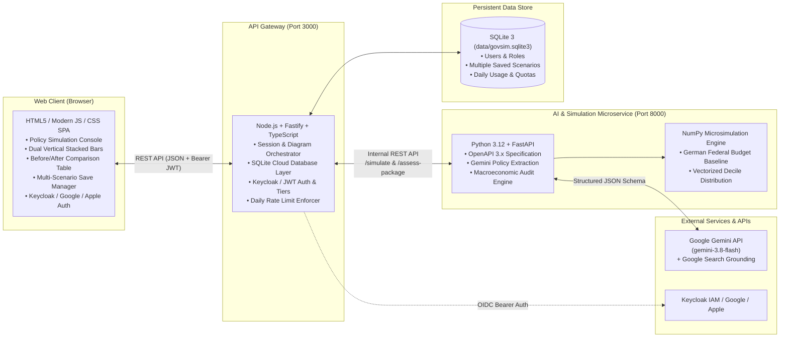

# GovSim AI — Interactive Policy & Fiscal Budget Simulation Platform

GovSim AI is an institutional macroeconomic microsimulation platform that translates natural-language policy ideas into structured fiscal parameters, computes deterministic budget impacts across adult income deciles and federal budget line items, and visualizes the resulting shifts in real time.

---

## 🏛️ Architecture Overview

The system follows a decoupled **Microservices Architecture** with a persistent self-contained database and open-source identity federation:



### Components

1. **`gateway_service` (Node.js + TypeScript / Fastify — Port 3000)**:
   - Serves the Single Page Application (SPA).
   - **Persistent SQLite Database (`better-sqlite3`)**: Stores users, accounts, daily query limits, and multiple named scenarios. No JSON files needed for saving work.
   - **Identity & Access Management (Keycloak / OIDC / Google / Apple)**: Supports Keycloak OpenID Connect Bearer tokens, federated social logins (Google & Apple ID), and local email/password authentication.
   - **Tier Quota & Rate Limiting**:
     - **Guest**: 1 test query preview.
     - **Free Registered**: 10 simulations/day + up to 10 cloud-saved scenarios.
     - **Pro (Journalists / Analysts)**: 250 simulations/day + 100 cloud-saved scenarios.
     - **Business**: Unlimited simulations & scenarios.
   - Orchestrates scenario simulations with `fiscal_ai_engine`.

2. **`fiscal_ai_engine` (Python 3.12 + FastAPI — Port 8000)**:
   - Integrates with Google `gemini-3.8-flash` via the `google-genai` SDK using strict Pydantic v2 schemas (`PolicyExtractionSchema`).
   - High-speed inference with zero heuristic fallbacks.
   - Vectorized deterministic microsimulation with **NumPy** calculating tax/transfer incidence across 68.8M adult citizens (10 income deciles) and departmental *Einzelpläne*.
   - Critical macroeconomic audit engine with live Google Search grounding evaluating fiscal multipliers, net wages, and statutory social security interactions.

3. **Data Transportability**:
   - All user data, saved scenarios, and rate-limit counters reside in a single file: `data/govsim.sqlite3`.
   - The entire platform + data can be transported in a single Docker volume or run out of a single container (`Dockerfile.all-in-one`).

---

## 🚀 Quick Start

### Prerequisites
- Node.js (v20+) and Python (v3.11+) **OR** Docker & Docker Compose
- A [Google Gemini API Key](https://aistudio.google.com/)

### 1. Configure Environment Variables
Copy `.env.example` to `.env` and insert your Gemini API key:
```bash
cp .env.example .env
```
Edit `.env`:
```env
GEMINI_API_KEY=your_actual_gemini_api_key_here
GEMINI_MODEL=gemini-3.8-flash
PORT=3000
FISCAL_ENGINE_URL=http://localhost:8000
UPSTREAM_TIMEOUT_MS=120000
DB_PATH=./data/govsim.sqlite3
JWT_SECRET=govsim-ai-secret-key-change-in-production
```

---

### Option A: Running Locally (Fastest)

#### 1. Start the Python Simulation Engine (`fiscal_ai_engine`)
```bash
# In project root
python -m venv .venv
source .venv/bin/activate  # On Windows: .\.venv\Scripts\activate
pip install -r fiscal_ai_engine/requirements.txt

python -m uvicorn fiscal_ai_engine.main:app --host 127.0.0.1 --port 8000 --reload
```
API Documentation available at [http://127.0.0.1:8000/docs](http://127.0.0.1:8000/docs).

#### 2. Start the Fastify Gateway (`gateway_service`)
In a second terminal:
```bash
cd gateway_service
npm install
npm run dev
```
Open **[http://localhost:3000](http://localhost:3000)** in your browser.

---

### Option B: Running with Docker Compose

To start both microservices and mount the persistent `data/` volume:
```bash
docker compose up --build
```
Open **[http://localhost:3000](http://localhost:3000)**.

To also spin up the open-source **Keycloak IAM** server with PostgreSQL and the pre-configured realm:
```bash
docker compose --profile auth up --build
```
Keycloak Administration Console will be accessible at [http://localhost:8080](http://localhost:8080) (Admin: `admin` / `admin_password`).

---

### Option C: Transportable All-in-One Container

To run the entire system (Fastify Gateway + Python Fiscal AI Engine + SQLite database) in a **single Docker container**:
```bash
docker build -f Dockerfile.all-in-one -t govsim-all-in-one .
docker run -p 3000:3000 -v ${PWD}/data:/app/data -e GEMINI_API_KEY="your-key" govsim-all-in-one
```
Everything runs together on port 3000 with your database safely persisted in `./data/govsim.sqlite3`.

---

## 🔒 User Accounts, Tiers & Multi-Scenario Saves

- **Multiple Saved Scenarios**: Registered users can save multiple named scenarios (e.g. *"CDU Tax Reform"*, *"Greens Climate Dividend"*) directly to the cloud database. Click **💾 Save Scenario** or **📂 My Scenarios** in the top navigation bar to save, load, update, or delete scenarios with one click.
- **Tiers & Limit Enforcement**:
  - **Guest**: 1 simulation preview across all sessions.
  - **Free Registered**: 10 simulations per day (resets daily at 00:00 UTC).
  - **Pro / Journalist**: 250 simulations per day, 100 cloud saves, priority search grounding.
  - Test tier switching is available directly in the UI under **⚡ Tiers**.
- **Social Login & Keycloak SSO**:
  - Click **Sign In** → **Continue with Google**, **Continue with Apple**, or **Sign in with Keycloak (SSO)**.
  - Keycloak realm configuration is pre-built in [`keycloak/govsim-realm.json`](keycloak/govsim-realm.json).
