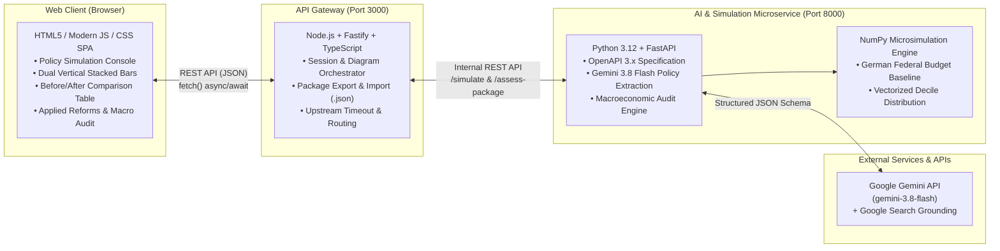

# GovSim AI — Interactive Policy & Fiscal Budget Simulation Platform

GovSim AI is an institutional macroeconomic microsimulation platform that translates natural-language policy ideas into structured fiscal parameters, computes deterministic budget impacts across adult income deciles and federal budget line items, and visualizes the resulting shifts in real time.

---

## 🏛️ Architecture Overview

The system follows a decoupled **Microservices Architecture**:



### Components

1. **`gateway_service` (Node.js + TypeScript / Fastify — Port 3000)**:
   - Serves the Single Page Application (SPA).
   - Orchestrates scenario simulation requests and manages active budget states.
   - Handles Reform Package export and import (JSON format).
   - Enforces timeout management (`UPSTREAM_TIMEOUT_MS`) and CORS policies.

2. **`fiscal_ai_engine` (Python 3.12 + FastAPI — Port 8000)**:
   - Integrates with Google `gemini-3.8-flash` via the `google-genai` SDK using strict Pydantic v2 schemas (`PolicyExtractionSchema`).
   - High-speed inference with zero heuristic fallbacks.
   - Vectorized deterministic microsimulation with **NumPy** calculating tax/transfer incidence across 68.8M adult citizens (10 income deciles) and departmental *Einzelpläne*.
   - Critical macroeconomic audit engine with live Google Search grounding evaluating fiscal multipliers, net wages, and statutory social security interactions.

---

## 🚀 Quick Start

### Prerequisites
- [Docker](https://www.docker.com/) & Docker Compose **OR**
- Node.js (v20+) and Python (v3.11+)
- A [Google Gemini API Key](https://aistudio.google.com/)

### 1. Configure Environment Variables
Copy `.env.example` to `.env` and insert your Gemini API key:
```bash
cp .env.example .env
```
Edit `.env`:
```env
GEMINI_API_KEY=your_actual_gemini_api_key_here
GEMINI_MODEL=gemini-3.8-flash
PORT=3000
FISCAL_ENGINE_URL=http://localhost:8000
UPSTREAM_TIMEOUT_MS=120000
```

---

### Option A: Running with Docker Compose (Recommended)

Build and run both services simultaneously:
```bash
docker compose up --build
```
Open **[http://localhost:3000](http://localhost:3000)** in your browser.

---

### Option B: Running Locally

#### 1. Start the Python Simulation Engine (`fiscal_ai_engine`)
```bash
# In project root
python -m venv .venv
source .venv/bin/activate  # On Windows: .\.venv\Scripts\activate
pip install -r fiscal_ai_engine/requirements.txt

python -m uvicorn fiscal_ai_engine.main:app --host 127.0.0.1 --port 8000 --reload
```
API Documentation will be available at [http://127.0.0.1:8000/docs](http://127.0.0.1:8000/docs).

#### 2. Start the Node.js API Gateway (`gateway_service`)
In a second terminal:
```bash
cd gateway_service
npm install
npm run dev
```
Open **[http://localhost:3000](http://localhost:3000)** in your browser.

---

## 📊 Features

- **Natural Language Policy Extraction**: Propose arbitrary fiscal reforms (e.g., *“+€27B Tech & Rail / Cut Subsidies”*, *“Climate Dividend + Carbon Tax”*).
- **Two-Step "Simulate & Apply" Workflow**: Review calculation feedback cards showing revenue, spending, and net deficit shifts before applying them to the active budget.
- **Dual Vertical Stacked Bar Chart**: Proportional visual representation of public revenues and deficit financing versus federal expenditures.
- **Before / After Comparison Table**: Detailed financial statement comparing baseline allocations with active reform states.
- **Reform Package Management**: Inspect all active reforms in a dedicated popup, export packages as `.json`, or import external packages.
- **Critical Macroeconomic Assessment**: One-click economic reality check factoring in statutory social security, disposable income, and consumption dynamics.

---

## 🔒 Security
- Secret credentials (`.env`) are strictly excluded from version control via `.gitignore`.
- Downstream simulation calls are encapsulated behind the Node.js API Gateway.
